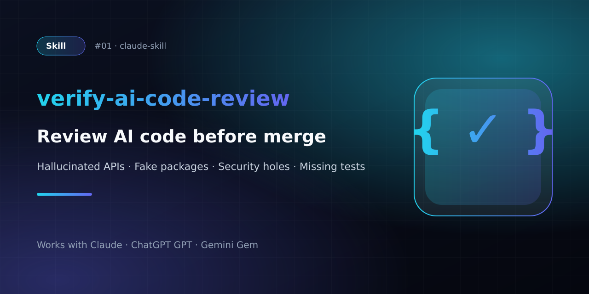

<p align="center"><a href="https://cloudskillhub.com"></a></p>

# verify-ai-code-review

🌐 **Website:** [cloudskillhub.com](https://cloudskillhub.com) · 📦 **All skills:** [skillhub](https://github.com/jahirulofficial0/skillhub)

Cross-AI skill that reviews AI-generated code before merge — hallucinated APIs, fake packages, security holes, missing tests — and returns a merge / fix-first verdict with a checklist.

**Works with:** Claude (Code, Desktop, claude.ai) · ChatGPT custom GPT · Gemini Gem

## Install

### Claude Code — this skill only
```
/plugin marketplace add jahirulofficial0/skillhub
/plugin install verify-ai-code-review@skillhub
```
Or directly from this repo: copy `skills/verify-ai-code-review/` into `~/.claude/skills/`.

### All 10 skills at once
See **[skillhub](https://github.com/jahirulofficial0/skillhub)** — one marketplace, or one MCP server that serves all 10 skills.

### claude.ai
Download `skills/verify-ai-code-review/` as a ZIP → **Settings → Capabilities → Skills → Upload skill**.

### ChatGPT / Gemini
- ChatGPT GPT: [`prompts/chatgpt-gpt.md`](prompts/chatgpt-gpt.md)
- Gemini Gem: [`prompts/gemini-gem.md`](prompts/gemini-gem.md)

## Usage
Just describe the task — the skill activates when relevant. Example:

> Review this before I merge (Python, written by an AI):

See [`examples/`](examples/) for a full input → output sample.

## What you get
```
## Verdict: MERGE | FIX FIRST | BLOCK
One-line reason.

## Findings
| # | Severity | Category | Location | Problem | Fix |
|---|----------|----------|----------|---------|-----|

## API / Package Reality Check
| Symbol / package | Status (verified/suspect/fake) | Note |

## Missing Tests
- [ ] test case …

## Pre-merge Checklist
- [ ] All `fake`/`suspect` items resolved
- [ ] Security findings fixed
- [ ] Tests added and passing
- [ ] Dependencies pinned

## Could not verify
- …
```

## Repository layout
```
.claude-plugin/plugin.json   Claude Code plugin manifest
skills/verify-ai-code-review/SKILL.md       The skill
prompts/                     ChatGPT GPT and Gemini Gem versions
examples/                    Sample input and output
assets/banner.png            Social preview image
```

## Author
**Jahirul** — [cloudskillhub.com](https://cloudskillhub.com) · [github.com/jahirulofficial0](https://github.com/jahirulofficial0)

## License
MIT — see [LICENSE](LICENSE).
